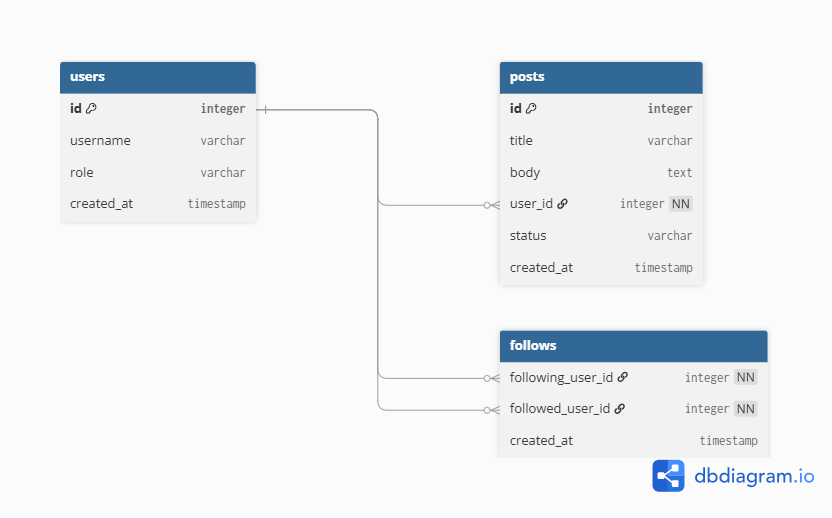

# Job Application Tracker API


REST API built with Laravel to track job applications through hiring stages.

## Features
- Token authentication (Laravel Sanctum)
- Full CRUD for job applications
- Status workflow: wishlist, applied, interview, offer, rejected
- Filtering by status and search by company name
- Authorization with Policies (users can only access their own data)
- Pagination, API Resources, Form Request validation
- Feature tests with Pest

## Tech Stack
Laravel 13, PHP 8.4+, MySQL, Sanctum, Pest

## Installation
```bash
git clone https://github.com/hajaj-Murad-M-2001/job-app-tracker.git
cd job-app-tracker
composer install
cp .env.example .env
cp .env.example .env
php artisan key:generate
# configure your database in .env
php artisan migrate --seed
php artisan serve
```

Demo account: `demo@example.com` / `password`

## API Endpoints
| Method | Endpoint | Description | Auth |
|---|---|---|---|
| POST | /api/register | Register | No |
| POST | /api/login | Login | No |
| POST | /api/logout | Logout | Yes |
| GET | /api/applications | List (`?status=`, `?search=`) | Yes |
| POST | /api/applications | Create | Yes |
| GET | /api/applications/{id} | Show | Yes |
| PATCH | /api/applications/{id} | Update | Yes |
| DELETE | /api/applications/{id} | Delete | Yes |

All requests must send `Accept: application/json`. Protected routes need `Authorization: Bearer <token>`.

## Testing
```bash
php artisan test
```

## Database Schema




## API Documentation

A ready-to-import collection is available at [docs/postman_collection.json](docs/postman_collection.json) (works with Postman, Insomnia, or Thunder Client). Set the `token` variable after logging in.

